# 📅 Smart Farm Management System (SFMS)
## 45-Day Project Implementation Timeline & Gantt Schedule

**Student Name:** Anil Tripathi  
**Project Title:** Smart Farm Management System (SFMS)  
**Total Duration:** 45 Days  
**Tech Stack:** Flutter (Mobile/Web), Node.js, Express.js, MongoDB  

---

### 1. Milestone Progress Table (45-Day Schedule)

| # | Milestone Description | Planned Timeline | Actual Progress | Status / % Done |
| :-: | :--- | :--- | :--- | :-: |
| **1** | **Project Initiation & Setup** • VS Code, Flutter SDK, Node.js, MongoDB setup • GitHub repository initialized and remote linked • Abstract, acknowledgements & initial scope definition | **Days 1 – 5** | Completed on schedule in Day 4 | **100%** |
| **2** | **System Analysis & Design** • Requirement gathering and feasibility study • UML diagrams: Use Case, Activity, Class, and ER diagrams • REST API architecture and endpoint specifications | **Days 6 – 12** | All 4 diagrams completed and reviewed | **100%** |
| **3** | **Database & Authentication Subsystem** • MongoDB schema design (User & Animal models) • REST APIs: Signup, Login, Profile with JWT & bcrypt • Flutter screens: Login and Signup UI integration | **Days 13 – 19** | Completed backend routes and frontend authentication flow | **100%** |
| **4** | **Core Livestock & Task Management** • Animal setup: Individual and group animal entry • Animal types: Cow, Buffalo, Goat, Chicken, Pig • Daily tasks engine (TaskService) with local storage • Dashboard summary cards and statistics | **Days 20 – 28** | Core management screens implemented and operational | **90%** |
| **5** | **Advanced Features & System Integration** • Livestock health scan, image capture & file upload • Adaptive network resolver (Localhost, LAN IP, Emulator) • In-app server settings dialog and diagnostics • Full frontend-to-backend API connectivity | **Days 29 – 35** | Network resilience & core integrations complete; polishing scan details | **85%** |
| **6** | **System Testing, Quality Assurance & Bug Fixing** • API testing (duplicate checks, validation, edge cases) • Mobile cross-platform testing (Android & Web) • UI polishing, responsive layouts and bug fixes | **Days 36 – 40** | Unit tests and API validation performed; end-to-end device testing ongoing | **50%** |
| **7** | **User Evaluation, Final Thesis & Demo Preparation** • User evaluation and feedback collection • Final thesis write-up, results, and critical evaluation • Presentation slides, project poster, and demo video | **Days 41 – 45** | Thesis chapters drafted; final evaluation and demo in preparation | **30%** |

---

### 2. Mermaid Gantt Chart (Days 1 to 45)

```mermaid
gantt
    title Smart Farm Management System - 45-Day Timeline
    dateFormat X
    axisFormat Day %d

    section Phase 1: Setup
    Environment Setup & Project Scope       :done, p1, 1, 5

    section Phase 2: Design
    UML Modeling & System Architecture      :done, p2, 6, 12

    section Phase 3: Auth & DB
    MongoDB Schema & JWT Authentication     :done, p3, 13, 19

    section Phase 4: Core Features
    Animal Management & Daily Tasks         :active, p4, 20, 28

    section Phase 5: Integration
    Health Scanning & API Integration       :active, p5, 29, 35

    section Phase 6: Testing
    System Testing & Bug Fixing             :p6, 36, 40

    section Phase 7: Thesis & Demo
    User Evaluation & Final Submission      :p7, 41, 45
```

---

### 3. Action Plan (Remaining Days)

| Action Item | Target Days | Completion Criteria |
| :--- | :---: | :--- |
| **Finalize Image Scanning & Results Display** | Days 33 – 35 | TFLite scan results display diagnosis and advice accurately |
| **Comprehensive End-to-End Testing** | Days 36 – 38 | Zero unhandled exceptions across all auth, animal, and task flows |
| **User Feedback & Evaluation Survey** | Days 39 – 41 | Farmer evaluation questionnaire completed and analyzed |
| **Final Thesis Documentation** | Days 42 – 44 | All chapters (1 to 8), references (Harvard format), and appendices compiled |
| **Project Presentation & Final Demo** | Day 45 | Slide deck, poster, and working live application demo ready |
